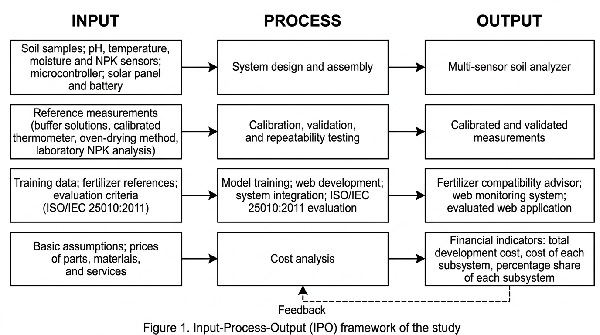
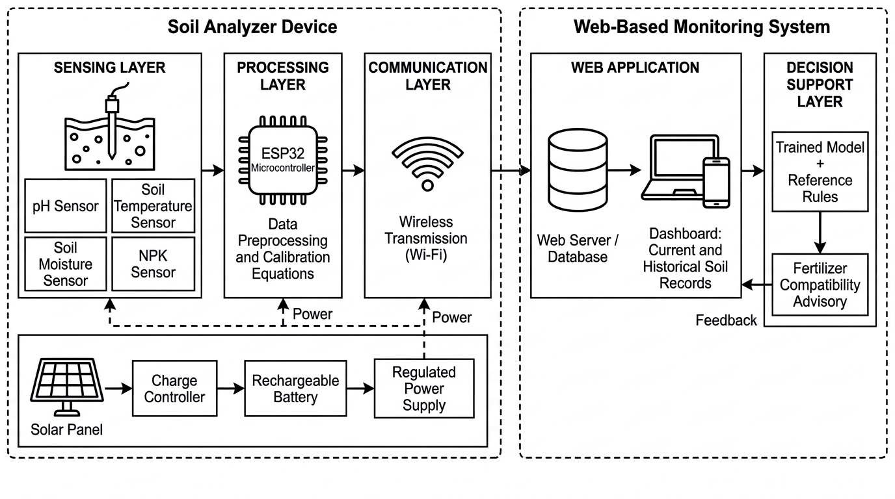
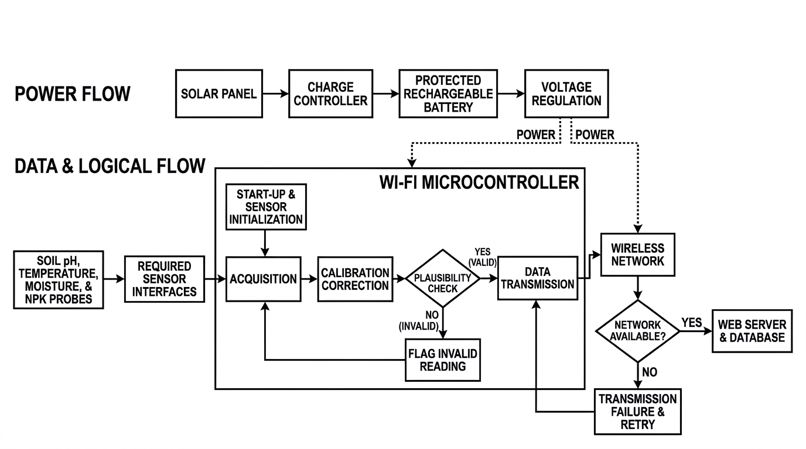
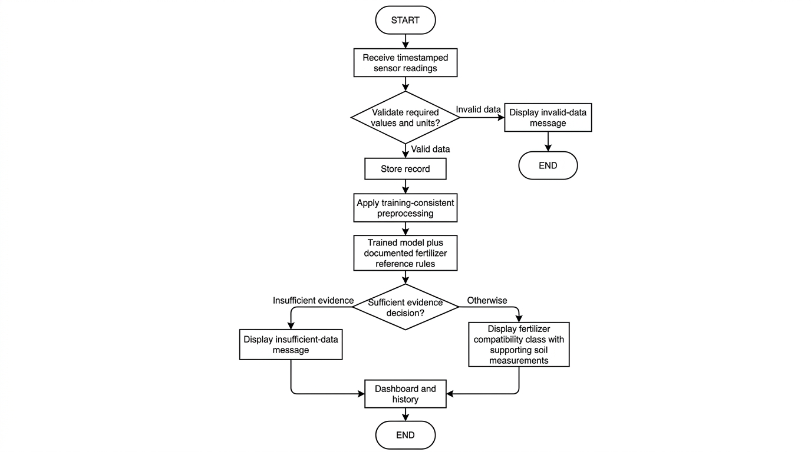

# HYBRID MULTI-SENSOR SOIL ANALYZER WITH FERTILIZER COMPATIBILITY ADVISOR AND WEB-BASED MONITORING SYSTEM

**ESRAEL N. TUYADANG**

An Undergraduate Thesis Presented to the Faculty of the Agricultural and Biosystems Engineering, College of Engineering, Nueva Vizcaya State University, Bayombong, Nueva Vizcaya in Partial Fulfillment of the Requirements for the Degree

**BACHELOR OF SCIENCE IN AGRICULTURAL AND BIOSYSTEMS ENGINEERING**

SEPTEMBER 2026

Readable Markdown transcription of an earlier paper draft. The paper text, tables, embedded figures, draft placeholders, and review comments are retained below. Page numbers are replaced with links for navigation; earlier Word drafts are available in the Git history.

The current proposal is [initial_paper.docx](docs/initial_paper.docx). It proposes limited offline recording in onboard flash, later upload over a configured Wi-Fi connection, and a web dashboard in place of a device screen. The Markdown transcription below and existing Blender models document earlier versions. See [the revision notes](docs/OFFLINE_SCREENLESS_REVIEW.md) for the scope changes and implementation limits.

Supporting references: [technical cheat sheet](docs/TECHNICAL_CHEAT_SHEET.md), [Word technical cheatcode](docs/technical-cheatcode.docx), and [researched materials budget](docs/MATERIALS_BUDGET_RESEARCH.md).

For device parts, calibration supplies, shared reference equipment, and testing expenses, see the [complete materials and testing budget checklist](docs/COMPLETE_MATERIALS_AND_TESTING_BUDGET.md).

Marketplace sourcing: [Shopee candidate listings and remaining purchasing checklist](docs/SHOPEE_PURCHASING_CHECKLIST.md).

Software starter: [system setup and stack](docs/SYSTEM_SETUP.md), [web application](apps/web), [database migration](supabase/migrations/202611040001_initial.sql), and [firmware scaffold](firmware). Run `npm run dev` from `apps/web` to open the initial dashboard. Hardware acquisition, user login, and the trained advisor remain to be implemented.

## Contents

- [Acceptance Sheet](#acceptance-sheet)
- [List of Figures](#list-of-figures)
- [List of Tables](#list-of-tables)
- [Introduction](#introduction)
  - [Background of the Study](#background-of-the-study)
  - [Statement of the Problem](#statement-of-the-problem)
  - [Objectives of the Study](#objectives-of-the-study)
  - [Significance of the Study](#significance-of-the-study)
  - [Scope and Delimitation](#scope-and-delimitation)
  - [Time and Place of the Study](#time-and-place-of-the-study)
  - [Definition of Terms](#definition-of-terms)
- [Review Of Related Literature And Studies](#review-of-related-literature-and-studies)
  - [Soil Testing and Soil Fertility Assessment](#soil-testing-and-soil-fertility-assessment)
  - [Soil pH Monitoring](#soil-ph-monitoring)
  - [Soil Moisture Monitoring](#soil-moisture-monitoring)
  - [Soil Temperature Monitoring](#soil-temperature-monitoring)
  - [NPK Monitoring](#npk-monitoring)
  - [Multi-Parameter Soil Sensing](#multi-parameter-soil-sensing)
  - [Internet of Things in Smart Agriculture](#internet-of-things-in-smart-agriculture)
  - [Wireless and Web-Based Monitoring](#wireless-and-web-based-monitoring)
  - [Fertilizer Recommendation and Compatibility](#fertilizer-recommendation-and-compatibility)
  - [Trained Models and Machine Learning in Agricultural Decision Support](#trained-models-and-machine-learning-in-agricultural-decision-support)
  - [Solar and Rechargeable Power for Field Devices](#solar-and-rechargeable-power-for-field-devices)
  - [Web Application Quality Evaluation Using ISO/IEC 25010:2011](#web-application-quality-evaluation-using-isoiec-250102011)
  - [Related Studies and Research Gap](#related-studies-and-research-gap)
- [Methodology](#methodology)
  - [Conceptual Framework](#conceptual-framework)
  - [Components of the Device](#components-of-the-device)
  - [System Architecture](#system-architecture)
  - [Instrumentation](#instrumentation)
  - [Hardware Development](#hardware-development)
  - [Firmware and Data Acquisition](#firmware-and-data-acquisition)
  - [Calibration Procedure](#calibration-procedure)
  - [Calibration and Validation Metrics](#calibration-and-validation-metrics)
  - [Repeatability Testing](#repeatability-testing)
  - [Dataset Preparation and Trained Model Development](#dataset-preparation-and-trained-model-development)
  - [Fertilizer Compatibility Advisory](#fertilizer-compatibility-advisory)
  - [Web-Based Application Development](#web-based-application-development)
  - [Web Application Assessment Using ISO/IEC 25010:2011](#web-application-assessment-using-isoiec-250102011)
  - [Technical Evaluation Procedure](#technical-evaluation-procedure)
  - [System Integration and Functional Testing](#system-integration-and-functional-testing)
  - [Recommendation Validation](#recommendation-validation)
  - [Simple Cost Analysis](#simple-cost-analysis)
  - [Statistical Treatment of Data](#statistical-treatment-of-data)
  - [Ethical and Safety Considerations](#ethical-and-safety-considerations)
- [References](#references)
- [Review Comments](#review-comments)

## Acceptance Sheet

```text
NVSU RDD FORM NO. 3
ACCEPTANCE SHEET
This thesis attached hereto, entitled “HYBRID MULTI-SENSOR SOIL ANALYZER WITH FERTILIZER COMPATIBILITY ADVISOR AND WEB-BASED MONITORING SYSTEM”, prepared and submitted by ESRAEL N. TUYADANG in partial fulfillment of the requirements for the degree of BACHELOR OF SCIENCE IN AGRICULTURAL AND BIOSYSTEMS ENGINEERING is hereby accepted.

_________________________ ___________________________
Member, Advisory Committee Member, Advisory Committee
________________ ________________
Date Date


___________________________
Chair, Advisory Committee
________________
Date

Accepted as partial fulfillment of the requirements for the degree of BACHELOR OF SCIENCE IN AGRICULTURAL AND BIOSYSTEMS ENGINEERING

____________________________
Department Chair
___________________
Date

____________________________
Dean, College of Engineering
____________________
Date


RDD Index Contribution No.: __________ ________________________
Date: ______________________ Research MIS Coordinator
```

## List of Figures

- [Figure 1. Philippine Soil Test Kit described by the Food and Agriculture Organization](#figure-1)
- [Figure 2. Low-cost soil-moisture sensor setup reported by Gómez-Astorga et al. (2024)](#figure-2)
- [Figure 3. Input–Process–Output framework of the proposed study](#figure-3)
- [Figure 4. Proposed system architecture of the multi-sensor soil analyzer](#figure-4)
- [Figure 5. Proposed hardware and data-acquisition flow](#figure-5)
- [Figure 6. Proposed web monitoring and fertilizer advisory workflow](#figure-6)

## List of Tables

- [Table 1. Materials and components of the proposed system](#table-1)
- [Table 2. Proposed laboratory instruments and measurement records](#table-2)
- [Table 3. Proposed web application evaluation matrix](#table-3)

<a id="introduction"></a>

## Introduction

<a id="background-of-the-study"></a>

### Background of the Study

Effective soil management is important in crop production because soil conditions directly affect nutrient availability, water management, root development, and the ability of crops to obtain the nutrients they need. Farmers and agricultural practitioners therefore need timely information about soil properties before deciding whether fertilizer or other soil-management practices are necessary.

Traditional soil testing can provide useful information, but laboratory-based testing may require sample collection, transportation, preparation, waiting time, and access to laboratory facilities. In field situations, these requirements may make frequent testing less convenient. The Philippine Soil Test Kit is one example of a rapid field-oriented approach, but the Food and Agriculture Organization notes that the kit provides qualitative results for pH, organic matter, nitrogen, phosphorus, and potassium and is intended mainly for fertility monitoring and fertilizer recommendation rather than scientific research requiring actual nutrient quantities (Food and Agriculture Organization, n.d.).

Recent developments in smart agriculture have made sensors, microcontrollers, wireless communication, cloud platforms, and data analytics more accessible for agricultural applications. Reviews of agricultural Internet of Things (IoT) systems describe the use of sensors for soil moisture, temperature, pH, nutrients, and other field variables, with data transmitted to software systems for monitoring and decision support (Chamara et al., 2022; Gaur et al., 2022). Such systems can reduce the need for repeated manual observation and can make field information available through a digital interface.

Soil pH is an important soil property because it affects nutrient availability and the effectiveness of fertilizer management. Soil moisture and temperature are also useful measurements because they describe important physical and environmental conditions in the root zone. Nutrient information, particularly nitrogen (N), phosphorus (P), and potassium (K), can further support decisions concerning fertilizer application. A multi-sensor system that gathers these variables in one measurement session can therefore provide a more complete picture than a single-parameter sensor.

However, collecting measurements alone does not automatically provide a practical recommendation. Farmers or users still need to interpret the measured values and determine whether a fertilizer is compatible with the current soil condition. This creates an opportunity to combine sensing with a fertilizer compatibility advisor. The developed system is designed to use a trained model together with defined agricultural decision rules and stored reference information to transform sensor measurements into an understandable advisory output.

The project further incorporates a web-based monitoring system. A web interface can allow users to view current and historical measurements, monitor sensor readings, inspect advisory results, and store records for later comparison. IoT research shows that combining sensing, communication, software, and data processing is a common architecture for smart agriculture (Gaur et al., 2022; Chamara et al., 2022).

Power availability is another consideration for field use. The proposed analyzer therefore uses both rechargeable energy storage and solar charging. This arrangement is intended to support portable operation and reduce dependence on a continuous external electrical supply. The solar component is not intended to make the system completely independent of all external charging under every condition; rather, it provides an additional renewable charging source for field operation.

With these considerations, this study proposes the development of a Solar & Rechargeable Multi-Sensor Soil Analyzer with Fertilizer Compatibility Advisor and Web-Based Monitoring System. The study focuses on the development of the sensing device, calibration and validation of pH, temperature, moisture, and NPK measurements, integration of a trained model into a web application, assessment of the web application using ISO/IEC 25010:2011 as specified in the study, and a simple cost analysis.

<a id="statement-of-the-problem"></a>

### Statement of the Problem

Farmers still decide how much fertilizer to use with methods that are either not very exact or hard to get. The Philippine Soil Test Kit, for example, is a quick tool used in the field to check pH, organic matter, nitrogen, phosphorus, and potassium. But its results only tell if a nutrient is low, medium, or high. They do not give the real amount of each nutrient (Food and Agriculture Organization, n.d.). Laboratory tests can give real amounts, but samples must be collected, brought to the lab, and tested, and the farmer has to wait for the results. This makes frequent testing hard for farmers.

Electronic soil sensors were made to help with this, but the cheap ones available today also have problems. The Alliance of Bioversity International and CIAT (n.d.) tested low-cost handheld soil sensors in Guatemala and Colombia and compared them with laboratory results. The sensors were not very accurate, and their readings changed with the amount of water in the soil. This means they may not yet be reliable enough to guide fertilizer use. Calibration is also a problem. Gómez-Astorga et al. (2024) found that the readings of low-cost moisture sensors changed by up to 30% when the soil had biochar or different salt levels, so the sensors had to be calibrated for each soil. Other studies also point out that calibration, internet connection, power supply, and cost are still problems when sensors are used in the field (Chamara et al., 2022; Gaur et al., 2022; Sreeram et al., 2026).

Another problem is that many devices only show sensor readings. The farmer still has to understand the pH, moisture, temperature, and NPK values and decide if a fertilizer fits the soil, which is hard for those without training in agriculture. Field devices also need power, and a portable device that cannot be recharged in the field is hard to use. Few existing devices put calibrated sensors, a fertilizer advice feature, a web-based record system, and solar charging together in one low-cost device.

Because of these gaps, there is a need for a portable soil analyzer that measures pH, temperature, moisture, and NPK, and whose readings are calibrated and checked against standard methods and calibrated instruments. The readings should also be connected to a trained model that gives fertilizer advice, shown through a web-based monitoring system that is evaluated using ISO/IEC 25010:2011. The cost of making the device should also be known to see if it is affordable. This study therefore aims to develop a Hybrid Multi-Sensor Soil Analyzer with Fertilizer Compatibility Advisor and Web-Based Monitoring System, to check how accurate and consistent its readings are, to build and evaluate the web application, and to estimate the cost of development.

The research gap addressed by the present study is the integration of several functions in one undergraduate agricultural engineering prototype: multi-parameter soil sensing, calibration against reference measurements, a fertilizer compatibility advisor using a trained model, solar and rechargeable power, and web-based monitoring. The project further explicitly evaluates the web application and documents the direct development cost. The intended contribution is therefore an integrated prototype rather than a claim that any one sensor or software component is entirely new.

<a id="objectives-of-the-study"></a>

### Objectives of the Study

The general objective of the study is to develop a Hybrid Multi-Sensor Soil Analyzer with Fertilizer Compatibility Advisor and Web-Based Monitoring System.

Specifically, the study aims to:

1. Develop multi-sensor soil analyzer with compatibility advisor and web-based monitoring system.
2. Calibrate the device based on standard method and calibrated instrument in determining pH, temperature, moisture, and NPK.
3. Develop a web-based application that integrates the trained model and assess it according to ISO/IEC 25010:2011.
4. Perform simple cost analysis.

<a id="significance-of-the-study"></a>

### Significance of the Study

Farmers and Agricultural Practitioners. The system may provide field-level soil information and a more understandable fertilizer compatibility advisory. The web monitoring feature may also help users review previous measurements instead of relying only on a single field observation.

Agricultural and Biosystems Engineering Students. The project can demonstrate the application of sensors, instrumentation, embedded systems, renewable-energy support, IoT, data processing, and agricultural decision support in one prototype.

Researchers. The study may serve as a basis for improving low-cost soil sensing, model-based fertilizer advisory systems, web-based monitoring, and field validation procedures.

Agricultural Extension Personnel. A portable monitoring system may support demonstrations and field activities where rapid soil measurements are useful, subject to the accuracy limitations established through calibration.

Future Developers. The modular design can be improved by adding more crops, fertilizer products, communication methods, additional soil properties, improved models, or larger datasets.

Contribution to the Sustainable Development Goals (SDGs). The study supports SDG 2 (Zero Hunger) by developing a tool that may help users make more informed soil and fertilizer-management decisions. Its solar-charging feature relates to SDG 7 (Affordable and Clean Energy), while the integration of sensors and a web-based advisory system supports SDG 9 (Industry, Innovation and Infrastructure). These contributions are potential applications of the prototype and will depend on its validated performance and appropriate use.

<a id="scope-and-delimitation"></a>

### Scope and Delimitation

The study covers the design and development of a portable multi-sensor soil analyzer capable of measuring pH, soil temperature, soil moisture, and NPK-related readings using selected electronic sensors.

The system includes a microcontroller-based acquisition unit, rechargeable battery, solar charging component, enclosure, local sensor interface, wireless communication, database or cloud storage, and web-based monitoring interface.

The fertilizer compatibility advisor is limited to the crops, soil-condition ranges, fertilizer references, and training data defined by the researchers. The advisory output is a decision-support recommendation and does not replace laboratory soil analysis or professional agronomic advice.

The device will be calibrated using selected standard procedures and/or calibrated reference instruments. Calibration and validation will be conducted using soil samples and conditions accessible to the researchers.

The trained model will be developed from the dataset collected or assembled for the study. Model performance will depend on the quality, quantity, representativeness, and labeling of the dataset.

The web application will be assessed using selected quality characteristics of ISO/IEC 25010:2011 as specified in the study. ISO currently identifies the 2011 edition as withdrawn and lists ISO/IEC 25010:2023 as the current product quality model; therefore, the use of the 2011 edition in this thesis should be explicitly approved by the adviser or panel (International Organization for Standardization, 2011).

The cost analysis will cover the direct development costs of major hardware, electronic components, fabrication materials, software or service expenses incurred for the prototype, and other directly related development costs. It is not a full commercial feasibility or profitability study.

<a id="time-and-place-of-the-study"></a>

### Time and Place of the Study

The proposed development, calibration, and testing activities will be conducted at Nueva Vizcaya State University, Bayombong, Nueva Vizcaya, and at selected agricultural field locations, subject to permission and availability. The final study period and specific sampling sites will be entered after confirmation by the adviser: [START MONTH AND YEAR] to [END MONTH AND YEAR]; [FIELD SAMPLING LOCATIONS].[^comment-1]

<a id="definition-of-terms"></a>

### Definition of Terms

Calibration -The process of comparing sensor outputs with known or reference values and adjusting the system so that its readings better represent the reference measurements.

Compatibility Advisor - The decision-support component that interprets measured soil conditions and provides a fertilizer compatibility or suitability advisory based on the study's trained model and reference rules.

Internet of Things (IoT) - A system in which physical devices equipped with sensors, processing, and communication capabilities exchange data through a network.

Multi-Sensor Soil Analyzer - The developed device that combines several sensors to measure soil pH, temperature, moisture, and NPK-related variables.

NPK - The three primary plant nutrients nitrogen (N), phosphorus (P), and potassium (K).

Trained Model - A computational model developed from training data so that it can classify or predict an advisory output from selected soil measurements.

Web-Based Monitoring System - The online software component used to receive, store, display, and review measurements and advisory outputs.

ISO/IEC 25010:2011 - An international software and system quality model containing product-quality and quality-in-use characteristics. The 2011 edition is used in this study as specified by the research objectives, although ISO now lists it as withdrawn and identifies ISO/IEC 25010:2023 as the current product-quality standard.

<a id="review-of-related-literature-and-studies"></a>

## Review Of Related Literature And Studies

<a id="soil-testing-and-soil-fertility-assessment"></a>

### Soil Testing and Soil Fertility Assessment

Soil testing is used to obtain information about soil properties that can guide crop and soil-management decisions. Soil pH and nutrient status are particularly important because they affect nutrient availability and fertilizer decisions. In the Philippines, rapid field soil testing has been used to provide qualitative information that can support fertilizer recommendations. The FAO Asia-Pacific knowledge hub describes the Philippine Soil Test Kit as a rapid field tool for pH, organic matter, N, P, and K, while also noting that its results are qualitative and are not intended for scientific research requiring actual nutrient amounts (Food and Agriculture Organization, n.d.).

The proposed analyzer follows the same general need for rapid field information but attempts to combine multiple measurements in one device and connect those measurements to a digital monitoring and advisory system. The difference is therefore not simply the presence of a soil sensor; it is the integration of sensing, calibration, model-based interpretation, web monitoring, and portable power.

SOURCE IMAGE PLACEHOLDER — Insert an actual photograph or figure of the Philippine Soil Test Kit from the cited FAO source, with the original figure number, source URL, and required permission or license information. An AI image cannot document the actual cited kit. Delete this instruction after insertion.[^comment-2]

<a id="figure-1"></a>

**Figure 1. Philippine Soil Test Kit described by the Food and Agriculture Organization**

<a id="soil-ph-monitoring"></a>

### Soil pH Monitoring

Soil pH describes the acidity or alkalinity of soil and is commonly considered when evaluating nutrient availability and fertilizer management. Because pH can influence the chemical form and availability of nutrients, measuring it alongside other soil variables can provide useful context for interpretation. In the proposed system, pH is one of the core measurements used by the analyzer and may also serve as an input to the compatibility advisor.

<a id="soil-moisture-monitoring"></a>

### Soil Moisture Monitoring

Soil moisture is an important variable for crop production because water availability affects plant growth, nutrient movement, and irrigation decisions. Recent reviews describe the increasing use of sensor technologies, IoT, and machine learning for soil-moisture monitoring and prediction, while also identifying calibration, connectivity, energy, and cost as practical challenges in field deployment (Sreeram et al., 2026). The developed system includes soil moisture sensing so that the web application can present moisture information together with the other measured variables.

<a id="soil-temperature-monitoring"></a>

### Soil Temperature Monitoring

Soil temperature affects biological and physical processes in the soil and can change the environment experienced by plant roots and soil organisms. Including temperature in a multi-sensor analyzer provides additional context for interpreting soil measurements. The sensor will be calibrated against a suitable reference thermometer or calibrated instrument before validation.

SOURCE IMAGE PLACEHOLDER — Insert the actual low-cost soil-sensor or experimental-setup figure from Gómez-Astorga et al. (2024), Calibration of Low-Cost Moisture Sensors in a Biochar-Amended Sandy Loam Soil with Different Salinity Levels, https://doi.org/10.3390/s24185958. Verify the original figure number and attribution before insertion. Do not substitute an AI image as evidence of the published apparatus.

<a id="figure-2"></a>

**Figure 2. Low-cost soil-moisture sensor setup reported by Gómez-Astorga et al. (2024)**[^comment-3]

<a id="npk-monitoring"></a>

### NPK Monitoring

Nitrogen, phosphorus, and potassium are among the major nutrients required for crop production. IoT and sensor reviews identify NPK and other soil properties as important targets for agricultural sensing systems (Gaur et al., 2022; Jayaraman et al., 2023). However, electronic NPK sensors can have limitations associated with sensor type, soil condition, calibration, interference, and the relationship between sensor response and actual nutrient concentration. For this reason, the present study includes calibration and comparison against a reference method rather than treating raw sensor output as automatically accurate.

<a id="multi-parameter-soil-sensing"></a>

### Multi-Parameter Soil Sensing

A multi-parameter approach can provide more information than measuring a single soil variable. Agricultural IoT reviews describe systems that combine sensors, processing units, communication technologies, and software for monitoring environmental and soil conditions (Chamara et al., 2022; Gaur et al., 2022). Combining pH, moisture, temperature, and NPK-related measurements can allow the proposed advisory component to consider several soil conditions at the same time.

<a id="internet-of-things-in-smart-agriculture"></a>

### Internet of Things in Smart Agriculture

IoT-based agriculture generally connects physical sensing devices with communication networks, data processing, and user-facing applications. Chamara et al. (2022) reviewed Ag-IoT systems according to sensors, main boards, communication protocols, power supplies, crops, and applications. Gaur et al. (2022) likewise discussed IoT and sensors for monitoring soil nutrients, moisture, pH, temperature, and other agricultural variables. These studies support the architecture of the proposed project, in which sensor measurements are collected by a microcontroller and transferred to a web-based monitoring environment.

<a id="wireless-and-web-based-monitoring"></a>

### Wireless and Web-Based Monitoring

Web-based monitoring can convert sensor measurements into records that users can view through a browser. Such a system may include data acquisition, wireless transmission, server-side processing, database storage, and a dashboard. The main benefit for the proposed project is that the user can inspect current measurements and historical records without relying only on the local display of the physical device.

<a id="fertilizer-recommendation-and-compatibility"></a>

### Fertilizer Recommendation and Compatibility

Fertilizer recommendation is not simply a matter of selecting a fertilizer product. It depends on crop requirements, existing soil nutrient conditions, soil pH, and other agronomic factors. The Philippine Soil Test Kit example illustrates how field soil-test results can be interpreted to recommend the kind and amount of fertilizer for a particular crop, while its qualitative nature also shows why interpretation should be connected to the limitations of the measurement method (Food and Agriculture Organization, n.d.).

In the proposed study, compatibility is treated as a decision-support problem. The advisor will use selected soil variables and the training dataset to produce a compatibility classification or advisory output. Reference rules and database constraints may be retained as safety and consistency checks. The model will not be presented as a substitute for laboratory analysis.

<a id="trained-models-and-machine-learning-in-agricultural-decision-support"></a>

### Trained Models and Machine Learning in Agricultural Decision Support

Machine learning has increasingly been used in smart agriculture for prediction, classification, monitoring, and decision support. Reviews of smart agriculture describe the use of machine learning, data mining, deep learning, IoT, and sensing technologies across agricultural operations (Pandey et al., 2022). A trained model can be useful when multiple input variables need to be considered together and the available training data represent the target decision.

For the proposed project, the model-development process begins with data collection and cleaning. The dataset will contain selected sensor variables and the corresponding compatibility label or target output. Data will be divided into training and testing portions, and the selected model will be trained only on the training portion. The test portion will then be used to evaluate generalization. This separation is important because testing a model using the same observations used for training can give an overly optimistic estimate of performance.

The model will be integrated into the web application after calibration and model validation. This order is important because the model should receive measurements expressed in the same units and ranges used during training. If sensor calibration changes the scale of the raw readings, the model input-processing procedure must also be updated accordingly.

<a id="solar-and-rechargeable-power-for-field-devices"></a>

### Solar and Rechargeable Power for Field Devices

Portable agricultural electronics require a power source that can support sensing, processing, communication, and data storage. A rechargeable battery can provide stored energy while a solar panel can replenish the battery during suitable conditions. The developed system combines these two approaches to support field operation. Power consumption should be considered during component selection because wireless transmission and sensor operation can contribute substantially to energy demand.

<a id="web-application-quality-evaluation-using-isoiec-250102011"></a>

### Web Application Quality Evaluation Using ISO/IEC 25010:2011

ISO/IEC 25010:2011 defines a product quality model with eight characteristics and a quality-in-use model with five characteristics. The standard provides terminology and a framework for specifying and evaluating system and software quality (International Organization for Standardization, 2011). For this study, the researchers may select quality characteristics relevant to the developed web application, such as functional suitability, usability, reliability, performance efficiency, compatibility, security, maintainability, and portability, subject to the evaluation instrument approved by the research adviser.

ISO lists ISO/IEC 25010:2011 as withdrawn; the product-quality model is addressed by ISO/IEC 25010:2023 (International Organization for Standardization, 2011, 2023). The present study proposes to retain the 2011 model to align with its stated objective, subject to adviser and panel confirmation. This selection is a methodological decision of the researcher, not a recommendation made by the cited standard.

<a id="related-studies-and-research-gap"></a>

### Related Studies and Research Gap

Existing research shows that soil sensors and IoT systems can measure multiple agricultural variables and transmit information for monitoring and decision support. Reviews also identify continuing challenges related to sensor calibration, rural connectivity, energy requirements, cost, and field deployment (Chamara et al., 2022; Gaur et al., 2022; Sreeram et al., 2026).

<a id="methodology"></a>

## Methodology

This study will use a developmental and experimental research design. The developmental component will be used to design, assemble, program, and integrate the hardware and software components of the proposed system. The experimental component will be used to calibrate and validate the sensor measurements against selected standard methods and calibrated reference instruments.

The study will proceed through the following major stages: requirements identification; component selection; hardware and enclosure development; firmware development; solar and rechargeable power integration; calibration; data collection; trained-model development; web application development; system integration; validation; web application quality assessment; and cost analysis.

The development and testing activities will be conducted using available laboratory, workshop, computer, and agricultural field resources associated with the Agricultural and Biosystems Engineering program at Nueva Vizcaya State University, Bayombong, Nueva Vizcaya, with selected agricultural field locations used for soil-sample collection and field testing as appropriate.

<a id="conceptual-framework"></a>

### Conceptual Framework

The study follows an Input–Process–Output (IPO) framework. The inputs include soil samples, reference measurements, sensor components, microcontroller and communication hardware, power components, training data, fertilizer reference information, software requirements, and evaluation criteria. The process includes system design, hardware assembly, calibration, data collection, model training, web application development, integration, validation, ISO/IEC 25010:2011-based assessment, and cost analysis. The outputs include a functioning multi-sensor soil analyzer, calibrated measurement procedures, a trained-model compatibility advisor, a web-based monitoring system, quality evaluation results, and a documented development cost.

Feedback from calibration, model testing, and web application evaluation will be used to identify parts of the prototype that require adjustment before final testing.



<a id="figure-3"></a>

**Figure 3. Input–Process–Output framework of the proposed study**

<a id="components-of-the-device"></a>

### Components of the Device

<a id="table-1"></a>

**Table 1. Materials and components of the proposed system**

| Component/Material | Purpose | Remarks |
| --- | --- | --- |
| Microcontroller with Wi-Fi capability | Sensor reading, processing, and communication | ESP32-class board or equivalent |
| Soil pH sensor | Measurement of soil pH | Must be calibrated before testing |
| Soil moisture sensor | Measurement of soil moisture | Sensor type selected based on prototype design |
| Soil temperature sensor | Measurement of soil temperature | Compared with calibrated reference thermometer |
| NPK sensor/module | Estimation or measurement of soil N, P, and K | Validation method must match sensor output |
| Rechargeable battery | Energy storage | Capacity selected from system power requirement |
| Solar panel and charge controller | Battery charging support | Sized for prototype power demand |
| Voltage/current protection components | Power regulation and protection | Selected according to electronics |
| Enclosure and probe assembly | Protection and field handling | Designed for safe sensor placement |
| Web server/database platform | Data storage and monitoring | Platform selected based on availability |
| Computer/mobile device | Programming, dashboard access, and evaluation | Used during development and testing |

<a id="system-architecture"></a>

### System Architecture

The developed system consists of five main layers: sensing, processing, communication, web application, and decision support. The sensing layer contains pH, temperature, moisture, and NPK-related sensors. The processing layer contains the microcontroller that reads and preprocesses sensor values. The communication layer sends measurements through an available wireless connection. The web application stores and displays the measurements. The decision-support layer uses the trained model and reference information to generate the fertilizer compatibility advisory.



<a id="figure-4"></a>

**Figure 4. Proposed system architecture of the multi-sensor soil analyzer**

<a id="instrumentation"></a>

### Instrumentation

The proposed laboratory and field instruments are listed in Table 2. Final instrument models, calibration certificates, laboratory methods, measurement ranges, and uncertainties will be recorded before testing. The NPK reference method must quantify the same measurand and units as the sensor output; total nutrient content and extractable or available nutrient content will not be treated as interchangeable.

| Instrument or material | Purpose and required record |
| --- | --- |
| Calibrated pH meter; pH 4.00, 7.00 and 10.00 buffers | Reference pH checks; record buffer lot, temperature, calibration date, and selected soil preparation procedure. |
| Calibrated reference thermometer | Paired soil-temperature readings; record range, resolution, and calibration status. |
| Drying oven; balance; moisture tins; desiccator | Gravimetric moisture reference; document wet and dry mass, drying conditions, and moisture basis. |
| Soil auger or trowel; sample bags; labels; sieve; clean containers | Collect, identify, homogenize, and prepare paired samples; record site, depth, and preparation. |
| Laboratory N, P and K analyses | Qualified laboratory using documented methods; retain analytical reports, units, extraction basis, and detection limits. |
| Digital multimeter and suitable current or power meter | Check regulated supply, battery voltage, and operating power; record instrument range and measured operating mode. |
| Computer; browser tools; stopwatch or timing logger | Record task results, response times, browser conditions, and evaluation evidence. |

<a id="table-2"></a>

**Table 2. Proposed laboratory instruments and measurement records**

<a id="hardware-development"></a>

### Hardware Development

The hardware will be assembled in a modular arrangement so that individual sensors can be replaced or recalibrated without redesigning the entire system. Sensor interfaces will be connected to the microcontroller according to their electrical requirements. Power regulation will be separated from sensor signal wiring as much as practical to reduce electrical interference.



The enclosure will protect the electronic components during field handling. Sensor probes will be arranged so that they can be inserted into prepared soil samples or field soil at a consistent depth and procedure. The physical design will prioritize portability, access to the charging system, ease of cleaning, and replacement of sensors.

<a id="figure-5"></a>

**Figure 5. Proposed hardware and data-acquisition flow**

<a id="firmware-and-data-acquisition"></a>

### Firmware and Data Acquisition

The firmware will initialize the sensors, acquire readings, perform required conversion or preprocessing, apply calibration equations or correction factors, assign timestamps, and transmit the resulting values to the web system. The software will also handle communication failures and invalid readings through simple error-handling procedures.

To support repeatable measurements, the researchers will establish a fixed measurement procedure, including sample preparation, probe cleaning, stabilization time, measurement depth, number of readings, and recording interval. These conditions will be documented and applied consistently during calibration and validation.

<a id="calibration-procedure"></a>

### Calibration Procedure

Calibration shall be performed before final validation and prior to dataset collection to minimize systematic measurement errors. For pH calibration, standard buffer solutions (pH 4.00, 7.00, and 10.00) and/or reference soil samples shall be used. Multiple readings shall be obtained and calibration curves shall be developed through regression analysis. For temperature calibration, sensor readings shall be compared with a calibrated laboratory thermometer across the expected operating range. For moisture calibration, reference moisture values shall be determined using a suitable standard method such as the gravimetric oven-drying method, and calibration equations shall be developed. For NPK calibration, sensor outputs shall be compared with laboratory reference analyses using identical soil samples. The resulting calibration equations and correction factors shall be embedded into the firmware prior to validation and field testing.

- pH: Prepare or obtain reference solutions and/or soil samples with known or independently measured pH. Record the sensor response and compare it with the calibrated reference measurement. Develop an appropriate calibration relationship and verify it using separate observations.
- Temperature: Compare the sensor reading with a calibrated thermometer or temperature reference across the expected operating range. Determine the difference and apply correction if necessary.
- Moisture: Establish reference moisture conditions using a suitable standard or laboratory/reference method. Record sensor response at several moisture levels and develop a calibration relationship appropriate to the selected sensor.
- NPK: Compare the sensor's N, P, and K outputs with a selected calibrated reference method or laboratory result. Use the same sample preparation procedure for paired measurements and document the units and detection limitations of the sensor.

<a id="calibration-and-validation-metrics"></a>

### Calibration and Validation Metrics

Validation shall be conducted using independent soil samples that were not utilized during calibration. Sensor readings obtained from the developed device shall be compared with measurements obtained from calibrated reference instruments and laboratory-based analyses. At least three replications shall be performed for each sample to minimize random measurement error.

The agreement between the developed analyzer and reference measurements shall be evaluated using Absolute Error, Percentage Error, Mean Absolute Error (MAE), Root Mean Square Error (RMSE), Mean Absolute Percentage Error (MAPE), Coefficient of Determination (R²), Pearson Correlation Coefficient (r), and Bias Error where applicable. Regression analysis and graphical comparisons shall also be used to evaluate the relationship between device readings and reference measurements. Sensor performance shall be considered acceptable when error values remain within the allowable limits established by the selected reference standards.

<a id="repeatability-testing"></a>

### Repeatability Testing

Repeatability testing shall be conducted by obtaining at least ten consecutive measurements from the same soil sample under identical operating conditions. For each parameter, the mean, standard deviation, variance, and coefficient of variation (CV) shall be computed. The coefficient of variation shall serve as the primary indicator of repeatability, where lower CV values indicate greater measurement consistency and stability. Repeatability testing shall be performed at different measurement ranges to evaluate sensor reliability throughout the operating range.

<a id="dataset-preparation-and-trained-model-development"></a>

### Dataset Preparation and Trained Model Development

Multiple classification algorithms such as Decision Tree, Random Forest, and Support Vector Machine may be evaluated during model development. The final algorithm shall be selected based on predictive performance, computational efficiency, interpretability, and suitability for deployment within the web-based monitoring system.

The dataset shall be developed from calibrated soil measurements and corresponding fertilizer compatibility labels derived from agricultural reference information and expert recommendations. Dataset preparation shall include data collection, cleaning, preprocessing, transformation, and validation. Missing values, duplicate records, and outliers shall be identified and addressed appropriately. Numerical variables may be normalized or standardized, while categorical variables shall be encoded consistently. The dataset shall be divided into training, validation, and testing datasets. The selected machine learning model shall be trained using the training dataset and optimized using the validation dataset. Model performance shall be evaluated using accuracy, precision, recall, F1-score, and confusion matrix analysis. The model demonstrating the best balance of predictive performance, interpretability, and practical suitability shall be selected for integration into the web-based monitoring system.

<a id="fertilizer-compatibility-advisory"></a>

### Fertilizer Compatibility Advisory

Fertilizer compatibility labels shall be derived from documented agricultural references, fertilizer recommendation guides, and expert validation from qualified agriculture and agricultural engineering professionals. These references shall serve as the basis for assigning compatibility classes used during model training and validation.

The advisory component will receive calibrated soil variables and, where applicable, the selected crop or fertilizer category. The trained model will return the predicted compatibility class or advisory. The application will display the output in simple language and should also display the relevant measured values so that the user can see the basis of the recommendation.

Where the training dataset does not contain enough information to support a reliable prediction, the system should display an appropriate limitation or insufficient-data message instead of presenting a false level of certainty. The advisory is intended as decision support and not as a replacement for professional fertilizer recommendations or laboratory analysis.

<a id="web-based-application-development"></a>

### Web-Based Application Development

The web application will contain at least the following functional areas: user access or basic session control if required; dashboard; current sensor readings; historical records; fertilizer compatibility advisory; model output; and system information. The application will communicate with the database through an appropriate application programming interface or server-side connection.

- Dashboard: displays current pH, temperature, moisture, N, P, and K readings.
- History: stores and displays previous records using date and time identifiers.
- Advisory: shows the model-generated compatibility class and supporting soil values.
- Data management: provides controlled storage and retrieval of records.
- System status: displays connection or data-update status where feasible.



<a id="figure-6"></a>

**Figure 6. Proposed web monitoring and fertilizer advisory workflow**

<a id="web-application-assessment-using-isoiec-250102011"></a>

### Web Application Assessment Using ISO/IEC 25010:2011

The proposed evaluators will include Agricultural and Biosystems Engineering faculty members, information technology professionals, and potential end-users. Purposive sampling will be used to select evaluators suited to the criteria assigned to them. The number of evaluators, eligibility requirements, and final instrument will be established before recruitment and submitted for adviser approval. ISO/IEC 25010:2011 is retained provisionally to match the stated objective; its use remains subject to adviser and panel confirmation.

This study will use a researcher-prepared evaluation questionnaire based on the ISO/IEC 25010:2011 quality model, subject to adviser approval. The selected characteristics may include functional suitability, usability, reliability, performance efficiency, compatibility, security, maintainability, and portability. Respondents will rate statements using a defined Likert scale.

The mean rating for each characteristic and the overall mean will be computed using the approved rating interpretation. The questionnaire should be reviewed for clarity and, if required by the research panel, subjected to content validation before administration.

Because the 2011 standard has been withdrawn and superseded by newer standards, the final manuscript should state that the 2011 model is being used because it is the standard specified in the approved objective, unless the panel directs the researchers to revise the objective to the 2023 edition (International Organization for Standardization, 2011, 2023).

<a id="technical-evaluation-procedure"></a>

### Technical Evaluation Procedure

The following procedure is proposed by the researcher to operationalize the selected quality characteristics. It is not an ISO certification procedure. Before testing, the adviser will approve the selected characteristics, evaluator groups, task scripts, test data, operating conditions, and acceptance thresholds. A fixed application version and anonymized or synthetic test records will be used so that each evaluator encounters comparable conditions.

Each participant will receive an orientation and complete assigned tasks: open the dashboard, inspect a current reading and timestamp, retrieve a historical record, request a fertilizer compatibility advisory, and recognize an invalid reading or stale connection. The researcher will record task completion, errors, assistance required, elapsed time, and the participant’s rating. Participants may decline or withdraw; identifying details will be separated from response records.

<a id="table-3"></a>

**Table 3. Proposed web application evaluation matrix**

| Characteristic | Procedure and evidence |
| --- | --- |
| Functional suitability | Run a requirements-to-test-case checklist; compare displayed readings, stored records, and model outputs against prepared expected values. Record pass/fail and discrepancies. |
| Performance efficiency | Measure page loading, data refresh, and advisory response time over repeated trials. Log trial count, device, browser, connection, data volume, and concurrent load. |
| Compatibility | Repeat core tasks on the selected desktop and mobile browsers; check data exchange between acquisition unit, application interface, database, and model. |
| Usability | Observe task completion, navigation errors, help requests, and comprehension of units and advisory limitations. Obtain end-user ratings after task completion. |
| Reliability | Interrupt and restore connectivity in a controlled test; submit missing, duplicate, and invalid records. Check failure messages, recovery, and stored-data integrity. |
| Security | In an authorized test environment, check input validation, protected routes, session handling, and permissions where implemented; do not use real sensitive records. |
| Maintainability | Have qualified technical reviewers inspect code organization, configuration, documentation, logs, and the effort required for a controlled small change. |
| Portability | Document installation and configuration on the intended supported environment; record dependencies, responsive display behavior, and reproducibility of deployment. |

Technical reviewers will evaluate code- and configuration-dependent characteristics; end-users will evaluate only characteristics they can observe. A characteristic that cannot be assessed by a respondent will be marked not applicable and excluded from that respondent’s denominator. Technical test results will be reported separately from perception ratings.

A proposed five-point agreement scale will be used: 5 strongly agree, 4 agree, 3 neither agree nor disagree, 2 disagree, and 1 strongly disagree. Questionnaire items will describe observable behavior, be reviewed for content and clarity, and be pilot-tested before final administration. The mean item score will equal Σ(frequency × score)/number of valid responses. Characteristic means will be computed from valid item responses; any overall mean will state its weighting and exclusions. Rating bands, if required, will be approved before data collection. No score will be described as proof of ISO compliance.

<a id="system-integration-and-functional-testing"></a>

### System Integration and Functional Testing

After individual components have been tested, the hardware, firmware, web application, database, and trained model will be integrated. Functional tests will verify whether sensor data are acquired, transmitted, stored, displayed, and passed to the model correctly. The system will also be tested for common failure conditions such as temporary loss of connectivity, missing readings, and invalid input values.

<a id="recommendation-validation"></a>

### Recommendation Validation

A set of test samples not used for model training will be used to validate the fertilizer compatibility output. The model prediction will be compared with the expected label determined from the study's reference dataset and decision criteria. A confusion matrix and classification metrics will be used to describe the model's performance.

<a id="simple-cost-analysis"></a>

### Simple Cost Analysis

The percentage contribution of each major subsystem, including sensing components, power subsystem, communication subsystem, processing unit, enclosure, and web infrastructure, shall also be computed to identify the most significant contributors to prototype cost and provide recommendations for future cost optimization.

The total prototype development cost will be estimated by summing the direct costs of hardware, sensors, electronic components, enclosure materials, power components, fabrication, software or hosting expenses incurred for the prototype, and other directly attributable expenses.

The basic computation will be: Total Development Cost = Σ Cost of Hardware + Σ Cost of Software/Services + Σ Fabrication/Materials + Other Direct Costs. The analysis will describe the prototype development cost only and will not be presented as a full economic feasibility analysis unless additional production, maintenance, depreciation, labor, and benefit data are collected.

<a id="statistical-treatment-of-data"></a>

### Statistical Treatment of Data

- Descriptive statistics including mean, standard deviation, minimum, maximum, variance, and coefficient of variation shall be used to summarize sensor measurements and repeatability results.
- MAE, RMSE, MAPE, Relative Error, Pearson Correlation Coefficient (r), and Coefficient of Determination (R²) shall be used to evaluate agreement between sensor measurements and reference measurements.
- Repeatability shall be evaluated using standard deviation and coefficient of variation (CV).
- Classification metrics including accuracy, precision, recall, F1-score, and confusion matrix analysis shall be used to evaluate trained-model performance.
- Weighted Mean and descriptive interpretation shall be used to evaluate the ISO/IEC 25010:2011 assessment results.
- A Paired Sample t-Test at a 0.05 level of significance may be used to determine whether significant differences exist between device measurements and reference measurements, subject to adviser approval and statistical assumptions.

Let dᵢ be the device measurement, rᵢ the paired reference measurement, and n the number of independent paired observations. The proposed calculations are MAE = Σ|dᵢ − rᵢ|/n; RMSE = √[Σ(dᵢ − rᵢ)²/n]; and bias = Σ(dᵢ − rᵢ)/n. Percentage error and MAPE will be used only for quantities with a meaningful ratio scale and nonzero reference values. They will not be used as primary pH error measures. Temperature differences will be reported in degrees Celsius. CV will be reported only when the mean and measurement scale permit meaningful interpretation.

Calibration equations will be fitted using calibration observations only. Final accuracy estimates will use independent samples; replicate readings from the same sample will not be treated as independent soil samples. Training and test partitions will be separated by soil sample or collection group to prevent data leakage. Correlation and R² will be reported alongside error and bias because high correlation alone does not demonstrate measurement agreement. A nonsignificant paired t-test will not be interpreted as proof of equivalence.

<a id="ethical-and-safety-considerations"></a>

### Ethical and Safety Considerations

The prototype will be operated according to the electrical and equipment safety requirements of the laboratory and field-testing location. Electrical connections will be insulated and protected, and the rechargeable battery and solar charging components will be selected and operated according to their specifications. Soil samples and agricultural field activities will be handled using appropriate laboratory and field practices. The study will report limitations honestly and will not present unvalidated fertilizer recommendations as guaranteed agronomic advice.

<a id="references"></a>

## References

Chamara, N., Islam, M. D., Bai, G., Shi, Y., & Ge, Y. (2022). Ag-IoT for crop and environment monitoring: Past, present, and future. Agricultural Systems, 203, 103497. https://doi.org/10.1016/j.agsy.2022.103497

Estrada, O., Ramos, G., Lizarazo, M., & Jimenez, D. (2025). Digital transformation accelerator. Technical report of the probe: Low-cost portable soil fertility sensors: Myth or reality? Alliance of Bioversity International and CIAT. https://alliancebioversityciat.org/publications-data/digital-transformation-accelerator-technical-report-probe-low-cost-portable-soil

Food and Agriculture Organization. (n.d.). Asia-Pacific knowledge hub on sustainable soil and land management: Soil Test Kit. Food and Agriculture Organization of the United Nations. https://www.fao.org/asiapacific/work-in-the-region/regional-priorities/faorap-regional-priority-two/soil-management/capacity-building-and-knowledge-exchange/asia-pacific-knowledge-hub-on-sustainable-soil-and-land-management/en

Gaur, A., et al. (2022). Internet of things (IoT) and smart sensors in agriculture: Scopes and challenges. Internet of Things, 20, 100646. [Verify the final bibliographic details against the publisher record before submission.][^comment-4]

Gómez-Astorga, M. J., Villagra-Mendoza, K., Masís-Meléndez, F., Ruíz-Barquero, A., & Rimolo-Donadio, R. (2024). Calibration of low-cost moisture sensors in a biochar-amended sandy loam soil with different salinity levels. Sensors, 24(18), 5958. https://doi.org/10.3390/s24185958

International Organization for Standardization. (2011). ISO/IEC 25010:2011 Systems and software engineering — Systems and software Quality Requirements and Evaluation (SQuaRE) — System and software quality models. ISO.

International Organization for Standardization. (2023). ISO/IEC 25010:2023 Systems and software engineering — Systems and software Quality Requirements and Evaluation (SQuaRE) — Product quality model. ISO.

Jayaraman, P. P., Yavari, A., & others. (2023). Internet of things and smart sensors in agriculture: Scopes and challenges. [Verify author list, journal, volume, pages, and DOI from the publisher record before final submission.][^comment-5]

Pandey, C., Sethy, P. K., Behera, S. K., Vishwakarma, J., & Tande, V. (2022). Smart agriculture: Technological advancements on agriculture—A systematical review. In Deep Learning for Sustainable Agriculture. Academic Press. https://doi.org/10.1016/B978-0-323-85214-2.00002-1

Sreeram, R., Adithya Krishna, S., Kumar, A. S., Remya, S., & Cho, Y. Y. (2026). Soil moisture monitoring technologies in smart agriculture: A comprehensive review. Farming System, 4(2), 100189. https://doi.org/10.1016/j.farsys.2025.100189

## Review Comments

Comments carried over from the Word document. The numbered markers in the paper link to these notes.

[^comment-1]: **Aldwin Bernard V. Loreto:** change this into the actual values

[^comment-2]: **Aldwin Bernard V. Loreto:** insert

[^comment-3]: **Aldwin Bernard V. Loreto:** insert

[^comment-4]: **Aldwin Bernard V. Loreto:** verify

[^comment-5]: **Aldwin Bernard V. Loreto:** verify
