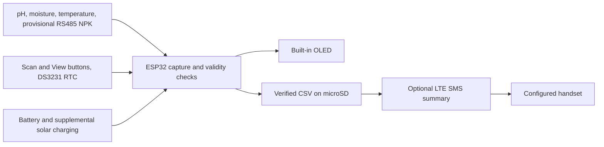

# Standalone soil reader study and system

## Scope

The prototype combines pH from a separate soil-water slurry, temperature and a moisture sensor in one ESP32 instrument. A compatible RS485 probe can add provisional raw N, P and K values pending feasibility and independent validation. A rechargeable battery supplies the reader, with supplemental solar charging. The ESP32 firmware draws the user interface on the built-in OLED and saves the field records to a removable microSD card. The optional LTE modem sends a short summary to a configured phone.

## Objectives

1. Develop the portable multi-sensor reader with on-device display, removable data storage and optional SMS.
2. Calibrate pH, temperature and moisture using suitable references, then evaluate agreement and repeatability on independent samples. Assess NPK feasibility using a probe with a documented measurement method and a compatible lab reference.
3. Evaluate the integrated reader using observed field tasks and selected ISO/IEC 25010:2023 product quality characteristics, including screen operation, data retention, SMS behavior and power performance. [ISO/IEC 25010:2023](https://www.iso.org/standard/78176.html)
4. Document actual direct prototype costs by sensing, controller, display and controls, storage and clock, communications, power and enclosure.

## Operating procedure

Power on with a FAT32 microSD card. Prepare the probes and sample, then wait for the approved stabilization time. Press Scan. The device applies configured calibration, shows sensor results and validity information, and saves a CSV once at least one usable value is available. A valid clock supplies an acquisition time. The OLED shows an unknown time when the clock is unavailable. After a confirmed save, an idle configured modem attempts one SMS submission. For a failed SD write, the screen displays the measurements and a save error. Turn off the device before removing the card and copy the saved CSVs to the research computer.

For button captures, write the displayed short scan ID next to the field sample ID in the notebook and match it to the complete record ID when importing. The serial interface can associate an explicit sample ID and location at capture time.

## Evidence to collect

- **Sensor agreement and repeatability.** Pair independent device and reference readings using matching methods and units. Preserve calibration records and keep calibration samples separate from final test samples. Report MAE, RMSE, bias and appropriate repeatability statistics. The firmware's moisture percentage is initially a reference index. Validate the conversion against a defined gravimetric or volumetric method before claiming a soil-moisture percentage.
- **Usability and storage.** Observe Scan and View tasks, interpretation of units and missing readings, and record retrieval from the card. Verify restart retention, logging with no cellular service, full-card behavior and interrupted writes.
- **SMS and power.** Record attempted, modem-submitted and handset-received counts, receipt latency, field carrier/coverage and the effect of network loss. Measure current during sensing, storage and SMS, then measure battery runtime and solar contribution under stated conditions.
- **Cost.** Track prices actually paid and distinguish borrowed equipment from cash expense. Include storage media, display, modem, SIM, power and test services if purchased.
